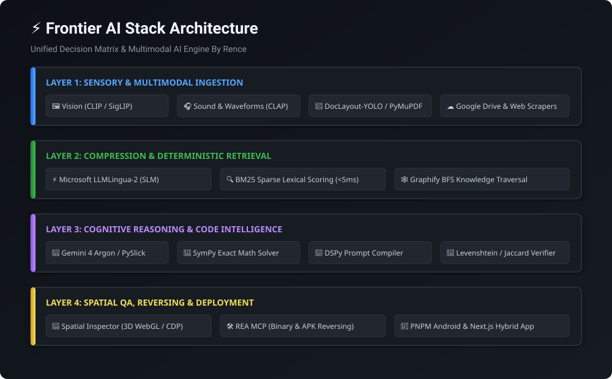
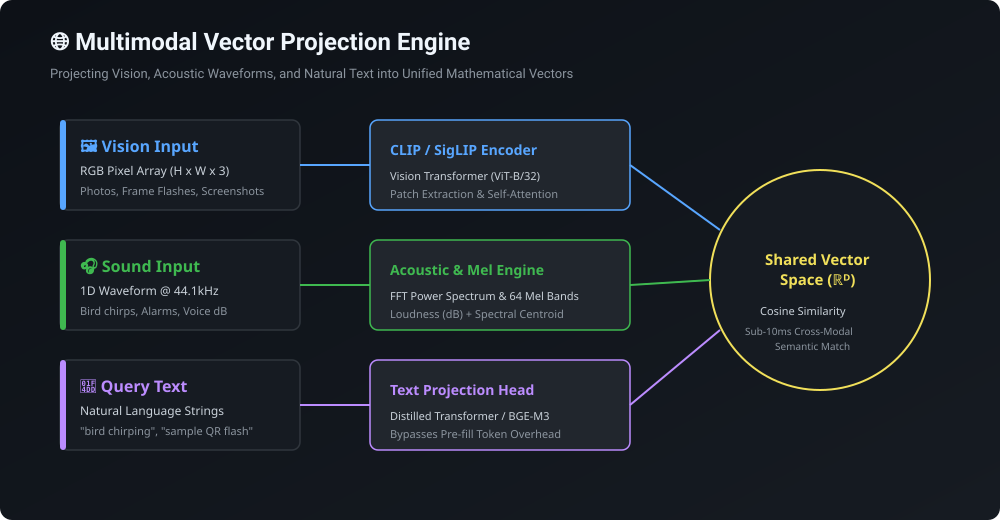

# Frontier AI Stack & Multimodal Engineering Suite (`Frontier-aiStack_ByRence`)

[](https://www.python.org/downloads/)
[](https://opensource.org/licenses/MIT)
[](#)
[](#)
[](#)
[](#)
[](#)

A unified frontier AI decision matrix, multimodal vectorization engine, offline mobile hybrid suite, and deterministic UI engineering framework. Built to replace fragile prompt engineering, sloppy design patterns, and unearned LLM token burns with **high-velocity token compression, cross-modal vector projection (Vision & Audio), sub-millisecond sparse retrieval (BM25), physical DOM hit-testing, and offline Android hybrid deployment.**

---

## 🏛️ System Architecture



---

## 🌐 Multimodal Vector Projection Engine



Projects **Images**, **Acoustic Waveforms (Sound & dB Loudness)**, and **Natural Language Text** into shared high-dimensional vector spaces for instant zero-shot classification and semantic search.

---

## ⚡ The Decision Matrix at a Glance

| Module / Domain | Tool / Directory | Core Capabilities & Triggers |
| :--- | :--- | :--- |
| **Multimodal Vision & Acoustics** | `scripts/multimodal_embeddings.py` | Encodes images to 512-dim CLIP vectors; extracts dB loudness, dominant pitch (Hz), spectral centroids, and Mel filterbanks for sound triage. |
| **High-Velocity Token Compressor** | `scripts/ml_compressor.py` | Microsoft LLMLingua-2 budget-constrained transformer token pruning (50%–70% compression, 0% semantic loss). |
| **Deterministic QA Engine** | `scripts/qa_engine.py` | Validates interrogative syntax and scores factual candidate answers via BM25 in $< 5\text{ms}$. |
| **Instant Transcript Search** | `scripts/search_transcript.py` | Traverses 10,000+ lines of lecture/video transcripts with BM25 Okapi and zero token cost. |
| **3D Kinetic Typography & Motion** | [`animtion-skill/`](animtion-skill/) | Virtual 3D camera rigs, frame-accurate typography, tilted spatial scrolling, and single-surface div morphing. |
| **Anti-AI Slop UI/UX Laws** | [`anti-slopSkill/`](anti-slopSkill/) | Strict anti-slop design system: 1 primary action, zero emoji slop, tactile 3D buttons, snapping, micro-animations, and full token fidelity. |
| **Offline Hybrid Android Engine** | [`pnpm-android-skill/`](pnpm-android-skill/) | Next.js + Capacitor + PNPM + Tailwind hybrid setup with offline Java routing and zero-bloat standalone APK deployment. |
| **Physical Layout & 3D Stacking** | [`spatial-inspector-skill/`](spatial-inspector-skill/) | Headless Chrome/Edge CDP 5-point hit testing, z-index traps, DOM stacking context analysis, and 3D WebGL anomaly visualizer. |

---

## 🧠 Frontier LLM Specialization Matrix (UI & Visual Engineering)

When designing, recreating, or refining user interfaces across this stack, triage tasks to the optimal frontier model:

| Model | Primary Role | When & How to Trigger |
| :--- | :--- | :--- |
| 🟣 **Claude** | **Decluttering UI (with UI Skill)** | Use Claude for clean, decluttered, zero-slop UI when combining with `anti-slopSkill`. Purges redundant card wrappers, eliminates emoji clutter, enforces visual hierarchy, and refactors messy layouts into disciplined design tokens. |
| 🔵 **Gemini Argon** | **Recreating the UI** | Use Gemini 4 Argon for high-reasoning UI reproduction and exact structural reverse-engineering. Excels at complex 3D WebGL / Three.js shaders, matrix transforms, frame-accurate kinetic animations, and pixel-precise architectural cloning. |
| 🟢 **ChatGPT** | **Creating Stunning UI from Images** | Use ChatGPT (GPT-4o) for generating stunning, modern UI directly from screenshot or mockup images. Interprets visual cues, color palettes, and reference artwork into high-polish frontend code. |

---

## 📦 Core Modules & Skills Breakdown

### 1. 🎬 Animation & Kinetic Typography (`animtion-skill/`)
- **Interactive Showcases**:
  - `higgsfield_katana_kinetic_typography_promo (2).html`: High-speed directional velocity blur, diagonal polygon shearing, and focal-plane Z-axis pop.
  - `motion_study_02_ui_morphing_showcase.html`: Single-surface UI morphing transitions without layout popping.
  - `opus_5_5_3d_scrolling_showcase.html`: Tilted spatial scrolling and depth-based perspective transforms.
  - `urban_markers_showcase (1).html`: Procedural web audio synthesis and synchronized visual cueing.
- **Apple HIG Guidelines**: Embedded HIG motion foundations (`apple-skill/`) ensuring native feeling interaction curves and spring physics.

### 2. 🛡️ Anti-AI Slop Design System (`anti-slopSkill/`)
- **Eliminates Generic "AI Slop" Patterns**:
  - Enforces strict visual hierarchy with at most **1 primary call-to-action** per viewport.
  - Strictly bans decorative emoji slop, unearned card divs, nested boxes, and low-contrast text camouflage.
  - Mandates tactile 3D button interactions, boundary separation, spring physics, and CSS token discipline.
- **Reference Assets & Specifications**: Includes `anti-slop-rules.txt`, `ui-laws.txt`, curated UI component packages, and production design templates.

### 3. 📱 PNPM Android Offline Hybrid Architecture (`pnpm-android-skill/`)
- **Offline-First Mobile Engineering**:
  - Hybrid application pipeline built on **Next.js**, **Capacitor**, **PNPM**, and **Tailwind CSS**.
  - Resolves asset protocol mapping (`https://localhost` vs `file:///android_asset`).
  - Implements offline Java routing bridges to prevent white-screen flashes on deep links.
  - AAPT asset exclusions and Gradle build optimization for zero-bloat, lightweight standalone APK binaries.
  - Comprehensive runbooks: `making android app.txt` and `making-an-android-offline-webapp.txt`.

### 4. 📐 Spatial Layout & Stacking Context Inspector (`spatial-inspector-skill/`)
- **Physical Geometry & Hit-Test Verification**:
  - Uses Edge/Chrome DevTools Protocol (CDP) to run 5-point hit testing across every interactive element.
  - Detects non-clickable "dead" buttons caused by invisible fixed headers, backdrops, or pointer-event traps.
  - Identifies CSS stacking context traps (`transform`, `opacity < 1`, `filter`, `perspective`).
  - Interactive **3D WebGL Stacking Viewer** (`3d-inspector.html` and `server.js`) rendering live DOM depth layers in real time.

---

## 🚀 Quickstart & Installation

### 1. Clone the Repository
```bash
git clone https://github.com/renneco27-crypto/Frontier-aiStack_ByRence.git
cd Frontier-aiStack_ByRence
```

### 2. Install Python Dependencies
```bash
pip install -r requirements.txt
```

---

## 🛠️ Tooling Runbook & CLI Usage

### 1. Multimodal Vision & Audio Vectors
```bash
# 1. Zero-shot match an image against candidate descriptions
python scripts/multimodal_embeddings.py match-image sample.png --prompts "bird, car, circuit board, receipt"

# 2. Extract acoustic fingerprint (loudness dB, dominant Hz, spectral centroid) from audio
python scripts/multimodal_embeddings.py triage-audio recording.wav

# 3. Generate raw 512-dim normalized image vector
python scripts/multimodal_embeddings.py image sample.png
```

### 2. Microsoft LLMLingua-2 Token Compressor
```bash
# Compress a verbose prompt down to a 50% token budget
python scripts/ml_compressor.py compress "In my opinion, as you can see, when configuring VirtualBox..." --rate 0.5

# Digest an entire directory of notes into high-velocity JSON vectors
python scripts/ml_compressor.py digest --dir ./notes --out ./roadmaps/high_velocity_digest.json --rate 0.5
```

### 3. Deterministic BM25 QA Engine
```bash
# Validate question syntax and retrieve factual verification passages
python scripts/qa_engine.py --docs ./documents --question "What is the network adapter mode?" --candidate "Host-Only"
```

### 4. High-Speed Video & Transcript Retrieval
```bash
# Search 10,000+ transcript lines with sub-second BM25 scoring
python scripts/search_transcript.py "port scanner socket"
```

### 5. Launch the 3D Spatial Inspector
```bash
cd spatial-inspector-skill
node server.js
# Open http://localhost:3000 to inspect live 3D element stacking contexts
```

---

## 📂 Repository Structure

```
Frontier-aiStack_ByRence/
├── assets/
│   ├── frontier_architecture.svg    # 4-Layer system architecture diagram
│   └── multimodal_pipeline.svg      # Vision, Audio & Text projection pipeline
├── scripts/
│   ├── multimodal_embeddings.py     # Vision (CLIP) & Audio acoustic vector engine
│   ├── ml_compressor.py             # Microsoft LLMLingua-2 prompt compressor
│   ├── qa_engine.py                 # BM25 deterministic QA verifier
│   └── search_transcript.py         # Sub-millisecond transcript search engine
├── animtion-skill/                  # 3D virtual camera rigs & kinetic typography
│   ├── apple-skill/                 # Apple HIG motion specifications
│   ├── references/                  # Motion study & typography formulas
│   └── *.html                       # Interactive kinetic 3D showcases
├── anti-slopSkill/                  # Anti-AI-slop design system & UI laws
│   ├── html/ & images/              # Verified visual showcases
│   ├── ui components/               # Production component library & tokens
│   ├── anti-slop-rules.txt          # Core engineering rules
│   └── ui-laws.txt                  # Visual hierarchy & tactile laws
├── pnpm-android-skill/              # Offline hybrid Android Next.js app engine
│   ├── android/ & src/              # Native Android + Capacitor template
│   ├── scripts/                     # Automated build & routing tools
│   └── making android app.txt       # Step-by-step engineering handbook
├── spatial-inspector-skill/         # Physical DOM hit-testing & 3D WebGL viewer
│   ├── engine/ & scripts/           # CDP hit-test & anomaly detection engine
│   ├── viewer/ & 3d-inspector.html  # Interactive 3D element visualizer
│   └── server.js                    # Spatial MCP server
├── SKILL.md                         # Antigravity master skill specification
├── requirements.txt                 # Python production dependencies
├── .gitignore                       # Clean Git exclusion rules
└── README.md                        # Documentation & Visual Guide
```

---

## 📄 License

MIT License. Created and maintained by **Rence** with **Google Antigravity**.
